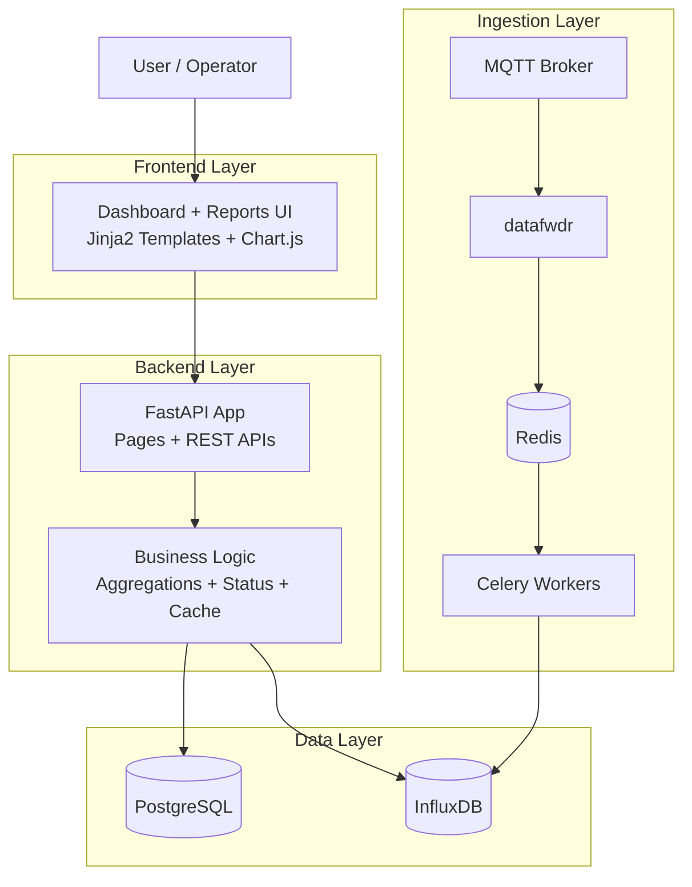
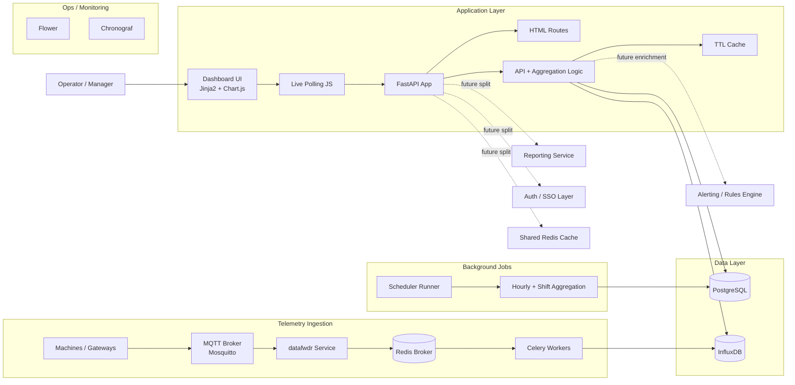

# Codebase Structure

## 1. High-Level Architecture

This repository is a SCADA-style production dashboard for print machines. It combines:

- A `FastAPI` web application for the dashboard UI and JSON APIs
- A `PostgreSQL` database for machine configuration and historical aggregates
- An `InfluxDB` time-series database for machine telemetry
- A `Redis + Celery` pipeline for asynchronous MQTT ingestion
- An `MQTT broker` for raw machine/device messages

At a business level, the platform does two jobs:

1. Ingest real-time machine telemetry from MQTT into InfluxDB
2. Convert that telemetry into operator-facing KPIs, shift metrics, and weekly trends in the dashboard

## 3. Major Modules And Responsibilities

### UI Layer

- `templates/dashboard.html`
  Renders the operator dashboard and polls backend APIs for:
  - `/api/snapshot/{machine_key}` every 15 seconds
  - `/api/shifts/{machine_key}` every 5 seconds
  - `/api/weekly/{machine_key}` every 30 minutes
- `templates/report.html`
  Provides a report-generation UI for hourly, shift, weekly, and custom exports
- `static/js/charts.js`
  Maps backend JSON into KPI cards, shift tables, and Chart.js visualizations

### Web/API Layer

- `main.py`
  Starts the main `FastAPI` app and mounts:
  - page routes from `routers/pages.py`
  - API routes from `routers/api.py`
- `routers/pages.py`
  Serves:
  - `/` -> dashboard
  - `/report` -> reports page
- `routers/api.py`
  Serves:
  - health endpoints
  - machine sync endpoint
  - machine list endpoint
  - KPI snapshot endpoint
  - shift analytics endpoint
  - weekly trend endpoint

### Business Logic Layer

- `utils/aggregations.py`
  Core business rules:
  - operational day reset at `07:00 IST`
  - pulses -> production meter conversion
  - run hour and energy KPI derivation
  - shift scoring and underperformance identification
  - daily aggregate persistence
- `utils/status.py`
  Determines whether a machine is in `RUN` or `STOP`
- `utils/cache.py`
  Avoids repeated InfluxDB reads for hot dashboard endpoints

### Data Access Layer

- `database.py`
  SQLAlchemy engine/session setup for PostgreSQL
- `models.py`
  Relational entities:
  - `MachineConfig`
  - `DailyProduction`
  - `ShiftProduction`
  - `HourlyProduction`
- `utils/influx.py`
  Reads time-series data from InfluxDB and calculates counter deltas

### Ingestion/Async Processing Layer

- `datafwdr/datafwdr.py`
  Subscribes to MQTT topics and forwards messages into Celery
- `celery-queue/tasks.py`
  Validates payloads, parses telemetry, and writes points into InfluxDB
- `api/api.py`
  Separate Flask microservice that can trigger Celery jobs and query task status

### Infrastructure Layer

- `docker-compose.yml`
  Orchestrates:
  - `app` (FastAPI dashboard)
  - `postgres`
  - `influxdb`
  - `redis`
  - `mosquitto`
  - `datafwdr`
  - `celery-tasks`
  - `monitor` (Flower)
  - `chronograf`
- `start.sh`
  Starts:
  - FastAPI workers
  - scheduler loop
  - machine initialization bootstrap

## 4. Key Dependencies

### Root App

- `fastapi`
- `uvicorn`
- `jinja2`
- `sqlalchemy`
- `psycopg2-binary`
- `requests`
- `pydantic-settings`

### Async/Ingestion Stack

- `celery`
- `redis`
- `paho-mqtt`
- `influxdb`
- `pytz`

### Frontend

- `Chart.js`
- `Bootstrap Icons`

# Application Flow Summary

## 1. End-to-End Data Flow

### A. Operator Dashboard Flow

1. A user opens `/`
2. FastAPI serves `dashboard.html`
3. Browser JavaScript starts polling backend APIs
4. FastAPI API endpoints load machine metadata from PostgreSQL
5. Aggregation utilities query InfluxDB for telemetry deltas
6. Results are transformed into snapshot, shift, and weekly KPI payloads
7. Frontend updates KPI cards, shift tables, and charts

### B. Telemetry Ingestion Flow

1. Machine/gateway publishes data to `Mosquitto` over MQTT
2. `datafwdr` subscribes to configured topics
3. `datafwdr` sends each message to `Celery` through `Redis`
4. `celery-queue/tasks.py` validates topic/payload structure
5. Worker parses tags and fields from telemetry JSON
6. Worker writes normalized time-series points into `InfluxDB`
7. Dashboard APIs later read those points to compute KPIs

### C. Historical Aggregation Flow

1. `start.sh` launches `utils.scheduler_runner`
2. Scheduler runs every 5 minutes
3. Shift aggregates are refreshed into PostgreSQL
4. Hourly aggregates are stored into PostgreSQL
5. Weekly endpoint backfills daily summaries when requested

## 2. Request/Response Path By Layer

### User -> Frontend

- User accesses dashboard or reports page
- Browser receives server-rendered HTML
- Browser uses JavaScript polling for live data refresh

### Frontend -> Backend

- `GET /api/snapshot/{machine_key}`
- `GET /api/shifts/{machine_key}`
- `GET /api/weekly/{machine_key}`
- `POST /api/init-machines`
- `GET /api/machines`

### Backend -> Database

- PostgreSQL stores:
  - machine configuration
  - hourly rollups
  - shift rollups
  - daily rollups
- InfluxDB stores:
  - raw or near-raw time-series telemetry
  - counters used for pulse, energy, and run-hour calculations

### Backend -> External Systems

- MQTT broker receives device events
- Redis transports async jobs
- Celery workers process and persist telemetry
- Flower and Chronograf support operational monitoring

## 3. Authentication, Middleware, And Control Points

### Authentication

- No application-level user authentication is currently implemented in the FastAPI app
- No role-based access control is present for dashboard or report pages
- Flower uses basic auth via environment variable, but that is isolated to the monitoring service

### Middleware

- No custom FastAPI middleware was found
- No request logging, auth middleware, or rate-limiting middleware is present in the main app

### Business Logic Highlights

- Production is derived from machine-specific physics:
  `production = (pulse_delta / pulses_per_revolution) * meters_per_revolution`
- Operational day resets at `07:00 IST`, not midnight
- Shift analytics compare run hours, production, speed, and energy efficiency
- Weekly charts rely on PostgreSQL summaries, while live KPIs rely on InfluxDB
- Short-lived TTL caching protects the most frequently polled endpoints

## 4. Module Interaction Summary

### Main Runtime

- `main.py` -> `routers/pages.py` + `routers/api.py`
- `routers/api.py` -> `database.py`, `models.py`, `utils/aggregations.py`, `utils/influx.py`, `utils/cache.py`
- `utils/aggregations.py` -> InfluxDB query helpers + PostgreSQL models

### Async Telemetry Runtime

- `datafwdr/datafwdr.py` -> `Redis/Celery`
- `celery-queue/tasks.py` -> `InfluxDB`
- `api/api.py` -> `Celery` task submission

### Config Runtime

- `routers/config_loader.py` reads `routers/config.txt`
- Config file maps machine keys to:
  - machine IDs
  - measurement names
  - pulse fields
  - energy fields
  - shift timings

## 5. Current Gaps To Be Aware Of

- The reports UI references APIs such as `/api/hourly/{machine}` and `/api/shift-history/{machine}`, but those endpoints are not defined in `routers/api.py`
- The current cache is in-memory only, so it does not scale cleanly across multiple FastAPI workers or containers
- Authentication and access control are currently absent
- The codebase mixes a primary `FastAPI` app with a separate `Flask` helper API, which increases operational complexity

# Mermaid.js Diagram / Blog Diagram

## Block Diagram

## Expanded Flow Diagram

## CEO-Friendly Narrative

The platform has two clear tracks:

- The left side is the business-facing dashboard that managers and operators use
- The right side is the telemetry pipeline that continuously collects machine data and converts it into KPIs

This separation is healthy because it allows the UI to stay lightweight while ingestion and calculations happen in specialized services behind the scenes.

# Expansion Recommendations

- Move the in-memory cache to shared `Redis` so caching works across multiple FastAPI workers and multiple app instances.
- Add an authentication layer in front of the dashboard and reports pages, especially if the app will be exposed outside a plant network.
- Split reporting into its own service once hourly and historical exports become heavier or more customized.
- Convert machine config from flat-file `routers/config.txt` into database-managed configuration for easier onboarding and change control.
- Introduce a proper API contract layer for reports because the frontend already expects endpoints that are not yet implemented.
- Add a queue-backed alerting/rules engine for conditions like machine stop, low throughput, or abnormal energy-per-meter.
- Consider separating telemetry ingestion from analytics completely if machine count grows significantly.
- Add a shared observability stack for API latency, queue lag, MQTT disconnects, and InfluxDB query performance.
- Put a reverse proxy or API gateway in front of the stack for TLS termination, rate limiting, and future SSO integration.
- Add CI/CD checks for schema drift, Docker health validation, and endpoint smoke tests.

## Likely Bottlenecks

- Repeated InfluxDB range queries on hot polling endpoints
- In-memory cache fragmentation across multiple Uvicorn workers
- Weekly endpoint doing on-demand backfill work before reading results
- Celery worker scaling pressure if MQTT message volume rises sharply
- Configuration and machine onboarding being tied to a text file

## Best Modular Growth Path

1. Add shared Redis caching and endpoint monitoring
2. Implement missing report APIs on top of existing PostgreSQL aggregates
3. Introduce auth and environment hardening
4. Extract reporting and alerting into separate services
5. Formalize machine onboarding/configuration in database tables and admin APIs
